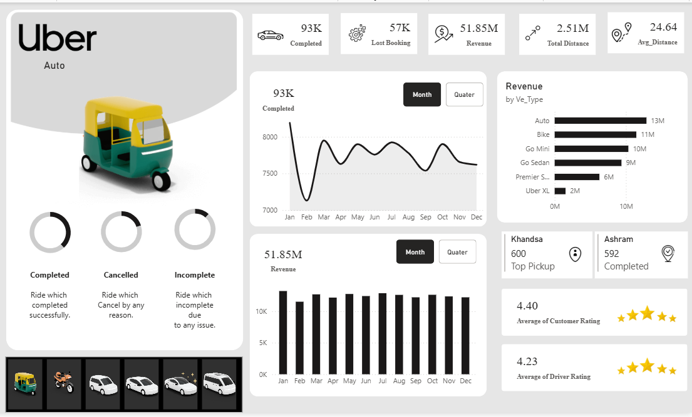

# Uber – Ride Booking & Business Performance Analytics

## Project Overview

An interactive Power BI dashboard designed to analyze Uber ride booking performance, revenue trends, vehicle categories, customer satisfaction, and operational efficiency.

The project transforms ride booking data into meaningful business insights through interactive visualizations and business intelligence techniques.

## Business Objectives

- Monitor ride booking and completion performance.
- Analyze revenue across different vehicle categories.
- Identify cancelled and incomplete ride patterns.
- Evaluate monthly and quarterly performance.
- Analyze customer and driver satisfaction.
- Identify high-demand pickup locations.

## Tools & Technologies

- Microsoft Power BI
- Microsoft Excel
- DAX (Data Analysis Expressions)
- Data Modeling
- Data Visualization
- Business Intelligence

## Key Performance Indicators

| KPI | Value |
|---|---:|
| Completed Rides | 93K |
| Lost Bookings | 57K |
| Total Revenue | 51.85M |
| Total Distance | 2.31M |
| Average Customer Rating | 4.40 |
| Average Driver Rating | 4.23 |

## Dashboard Features

- Interactive vehicle category selection
- Monthly and quarterly performance analysis
- Revenue analysis by vehicle type
- Completed, cancelled, and incomplete ride analysis
- Customer and driver rating analysis
- Pickup location analysis
- Dynamic dashboard navigation
- Interactive filters and visualizations

## Dashboard Preview

### 1. Home Page

### 2. Business Performance Overview

## Key Business Insights

- Auto generates the highest revenue among vehicle categories, at approximately 13M.
- Bike contributes approximately 11M in revenue.
- Uber XL records the lowest revenue among the displayed vehicle categories.
- Completed ride volume fluctuates throughout the year.
- Average customer ratings are higher than average driver ratings.
- Booking losses highlight opportunities to improve operational efficiency and ride completion.

## Repository Structure

| File | Description |
|---|---|
| uber.pbix | Interactive Power BI dashboard |
| uber.xlsx | Ride booking dataset |
| Home.png | Dashboard home page |
| Overview.png | Business performance dashboard |
| README.md | Project documentation |

## How to Use

1. Download the uber.pbix file.
2. Open the file using Microsoft Power BI Desktop.
3. Download the Excel dataset if required.
4. Update the dataset source path if necessary.
5. Explore the dashboard using interactive filters and navigation.

## Skills Demonstrated

- Data Analysis
- Business Intelligence
- Power BI Dashboard Development
- DAX Calculations
- Data Modeling
- KPI Analysis
- Revenue Analysis
- Customer Analytics
- Business Reporting
- Data Storytelling

## Conclusion

This project demonstrates how business intelligence can transform ride booking data into actionable insights, supporting revenue optimization, operational improvement, and customer experience analysis.

## Disclaimer

This project is developed for educational and portfolio purposes and is not an official Uber product.
